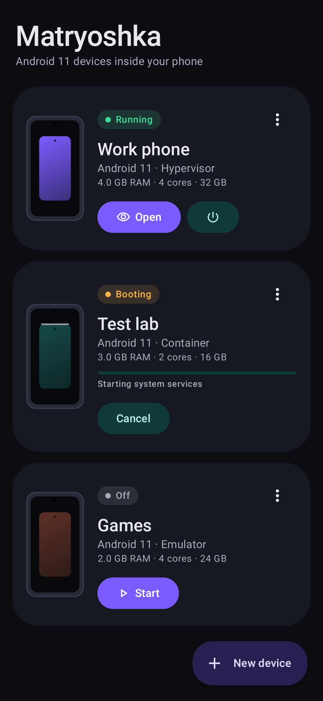
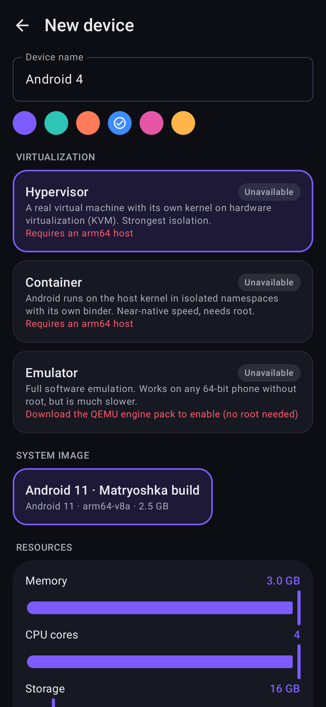
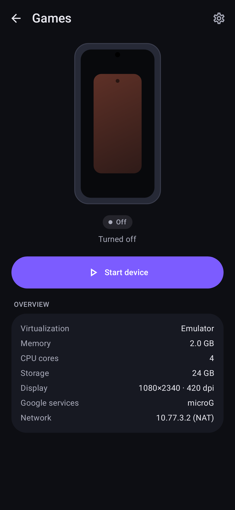
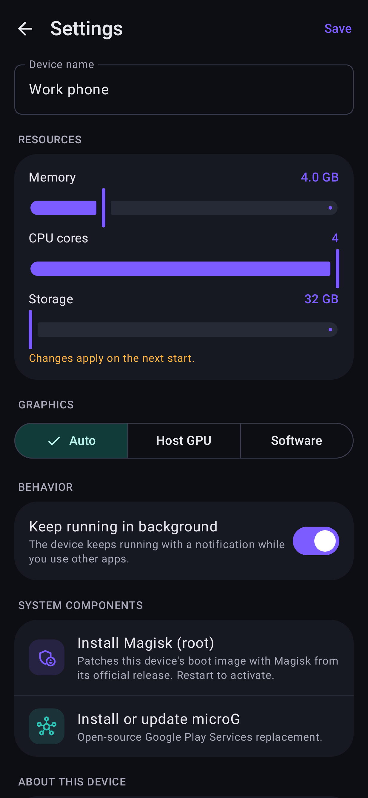
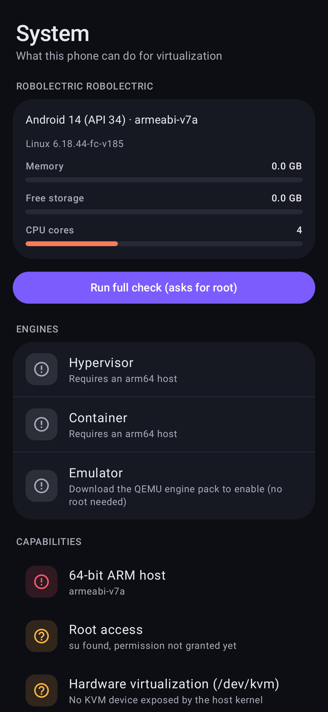

# Matryoshka — Android 11 внутри смартфона

**Matryoshka** — Android-приложение, которое запускает на телефоне полноценное изолированное
виртуальное устройство на **Android 11**: со своим ядром (или своими пространствами имён),
своей файловой системой и `/data`, своими приложениями и настройками. Также есть сервисы Google
(microG или ваши собственные GApps), root через **Magisk**, импорт и экспорт APK и обмен файлами
с основной системой.

Это не лаунчер и не «скин»: внутри работает настоящий `system_server`, свой `servicemanager`,
своя сеть. Экран гостя транслируется в приложение аппаратным H.264-потоком.

> Статус: **0.1, инженерная версия.** Приложение собирается, проходит юнит-тесты и Lint.
> На реальном устройстве цепочка «движок → гость → экран» ещё **не проверялась**, и
> гостевой образ ещё не собран. Подробности в разделе «Что проверено» и в
> [docs/LIMITATIONS.md](docs/LIMITATIONS.md).

## Как это устроено

```
┌──────────────────────── Хост: ваш телефон ─────────────────────────┐
│  Matryoshka (Kotlin, Jetpack Compose)                              │
│   ├─ VmManager ─ движки ─┬─ Hypervisor: crosvm + KVM (pKVM)        │
│   │                      ├─ Container:  namespaces + binderfs      │
│   │                      └─ Emulator:   QEMU TCG (без root)        │
│   ├─ ADB-клиент (свой) ──── приватная сеть 10.77.N.0/30 ───┐       │
│   └─ Дисплей: MediaCodec ◄── H.264 ◄───────────────────┐   │       │
│                                                        │   │       │
│   ┌──────────── Гость: Android 11 (AOSP, сжатый) ──────┴───┴─────┐ │
│   │ system_server · adbd · scrcpy-server · microG · Magisk       │ │
│   └──────────────────────────────────────────────────────────────┘ │
└────────────────────────────────────────────────────────────────────┘
```

Подробно — в [docs/ARCHITECTURE.md](docs/ARCHITECTURE.md).

### Три движка

| Движок | Что это | Требования | Изоляция | Скорость |
|---|---|---|---|---|
| **Гипервизор** | Настоящая ВМ со своим ядром (crosvm на KVM) | root, ядро с `/dev/kvm` (Pixel 6+ с pKVM и др.), arm64 | Самая сильная (граница ВМ) | Высокая |
| **Контейнер** | Гостевой userspace на ядре хоста: mnt/pid/net/ipc/uts-namespaces, свой binderfs | root, `CONFIG_ANDROID_BINDERFS` | Изоляция окружения, но не граница безопасности против root гостя | Почти нативная |
| **Эмулятор** | Полная эмуляция QEMU (TCG) | любой 64-битный телефон, root не нужен; отдельный engine-pack | Сильная | Низкая |

Экран «Система» в приложении сам определяет, какие движки доступны на этом телефоне, и
рекомендует лучший из них.

## Возможности

- Создание нескольких независимых устройств: имя, цвет, ОЗУ, ядра, размер диска (диск разреженный и
  занимает только реально использованное место), разрешение и DPI.
- Плавный UI на Material 3, тёмная и светлая тема, интерфейс на русском и английском.
- Живой экран гостя: мультитач, колесо мыши, аппаратная клавиатура и экранная клавиатура хоста,
  кнопки «Назад/Домой/Недавние», поворот, громкость.
- **Приложения:** импорт APK (в том числе split-наборы), установка через «Открыть с помощью» или
  «Поделиться» прямо из файлового менеджера, экспорт (`.apk` или `.apks`), запуск, удаление,
  очистка данных, отключение. Иконки и названия берутся из APK гостя.
- **Файлы:** просмотр `/sdcard` гостя, отправка файлов с телефона и скачивание обратно, папки.
- **Сервисы Google:** microG (Apache-2.0) ставится автоматически при первой загрузке. В образ
  встроен *ограниченный* signature spoofing: только для `com.google.android.gms` и
  `com.android.vending`. Есть режим «Свои GApps», где пакет ставите вы сами.
- **Root:** Magisk скачивается из официального релиза и патчит boot-образ своим же
  `boot_patch.sh` прямо внутри гостя (для движков «Гипервизор» и «Эмулятор»).
- Работа в фоне: foreground-сервис с уведомлением; при смене сети хоста (Wi-Fi ↔ мобильная)
  маршрут гостя перенастраивается.
- Образы общие для всех VM, проверяются по SHA-256, загрузку можно продолжить после обрыва.
  Можно импортировать собственный `.zip`.

## Сборка приложения

```bash
cd matryoshka
./gradlew assembleRelease      # app/build/outputs/apk/release/app-release.apk (~1.6 МБ)
./gradlew testDebugUnitTest    # юнит-тесты и скриншот-тесты UI (Robolectric + Roborazzi)
```

CI (`.github/workflows/matryoshka.yml`) собирает APK и прогоняет тесты на каждый push.

## Сборка гостевого образа Android 11

Образ собирается из исходников AOSP (`android-11.0.0_r48`), см. [guest/README.md](guest/README.md):

```bash
guest/tools/build-guest.sh ~/aosp ~/kernel/arch/arm64/boot/Image
# → guest/out/mvm-a11-arm64-YYYYMMDD.zip  (импортируется в приложении: «Образы → Импорт файла»)
```

Сборке нужна Linux-машина с примерно 400 ГБ диска и 32+ ГБ ОЗУ. Образ сжат: из него удалены
потребительские приложения (Browser, Camera, Dialer, Email, телефония, NFC и т. д.),
используются «плоские» APEX, нет Wi-Fi/BT/USB-стека, а в ядре только virtio-устройства.

## Что проверено

- ✅ Приложение компилируется (debug и release с R8), Android Lint без ошибок.
- ✅ 17 юнит-тестов: ADB-протокол, в том числе полный handshake с RSA-аутентификацией против
  фейкового adbd; формат публичного ключа; формат сообщений управления scrcpy; формат
  `ipconfig.txt` для Ethernet; разбор `pm list packages`; заголовки boot.img v2/v3;
  совместимость манифеста от `mkbundle.py` с моделью приложения; 5 скриншот-тестов экранов.
- ✅ Shell-скрипты движков проходят `shellcheck`.
- ⚠️ **Не проверено на реальном устройстве**: запуск crosvm и контейнера, загрузка гостя,
  трансляция экрана, патч Magisk. В этом окружении нет телефона с KVM/root и машины для
  сборки AOSP.
- ⚠️ Гостевой образ **ещё не собран**. Конфигурация в `guest/` — продуманная отправная точка,
  но первая сборка AOSP почти наверняка потребует доводки (имена HAL-модулей, sepolicy).

## Лицензии

Код Matryoshka распространяется по [Apache-2.0](LICENSE). Сторонние компоненты, их лицензии и то,
как они используются (встроены, загружаются отдельно или не распространяются вовсе), перечислены в
[THIRD_PARTY_NOTICES.md](THIRD_PARTY_NOTICES.md). Проприетарные компоненты (Google Play
Services и Play Store) приложение не скачивает и не распространяет.

Android — товарный знак Google LLC. Matryoshka — независимый проект.

## Скриншоты

Отрисованы настоящим Compose-кодом на JVM (скриншот-тесты Roborazzi):

| Устройства | Новое устройство | Устройство | Настройки | Система |
|---|---|---|---|---|
|  |  |  |  |  |
