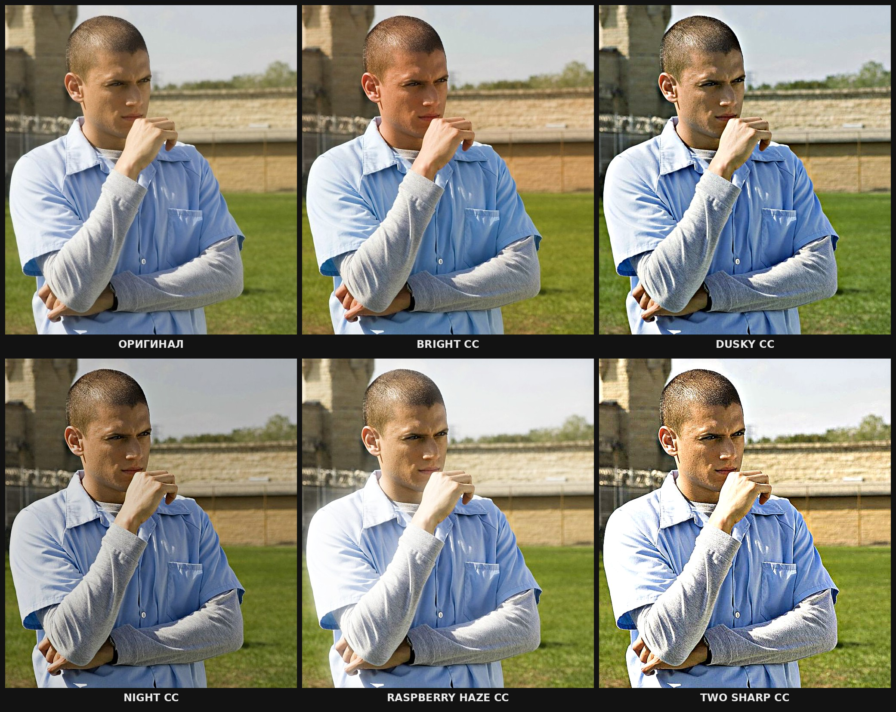

# ЦК — 5 готовых пресетов (Bright, Dusky, Night, Raspberry haze, Two sharp)

## ЭТАЛОН: ЦК обязаны выглядеть ровно так



`reference/ETALON.jpg` — утверждено пользователем. **Любой ЦК в любом эдите должен выглядеть как на этой картинке.**
Особенно **Raspberry haze**: мягкий белый свет-свечение вокруг светлых мест (рубашка, левый край кадра),
приподнятые чёрные, лёгкая малиновая дымка. Если свечения нет или оно другое — ЦК применён неправильно.

Попиксельные эталоны каждого ЦК: `reference/stills/scofield__<имя>.png` (кадр `scofield_frame.jpg`) и
`reference/stills/fury__<имя>.png` (кадр `fury_frame.jpg`). Повторный рендер совпадает с ними **бит в бит** (отличие 0).

## Как добиться эталона (для Claude)

1. Применять **только** `effectcraft/cc/apply_cc.py` — ничего не подбирать, не пересчитывать, не «улучшать»:
   ```python
   import sys; sys.path.insert(0, "tiktok/effectcraft/cc")
   from apply_cc import cc
   steps += cc("raspberry_haze", layer="$clip")   # слой С ВИДЕО, fx_start=N если на нём уже есть эффекты
   ```
2. **ЦК ставить на слой с видео, а не на adjustment-слой.** Проверено: Night на adjustment совпадает с эталоном,
   а у Raspberry haze свечение у краёв кадра становится темнее (до 17 уровней из 255 в полосе ~40 px по краям).
   Если клипов много — ЦК на каждый клип-слой (или прекомпоз всех клипов и ЦК на слой прекомпоза).
3. **Ничего не ставить на слой перед ЦК** (резкость, цвет и т.п. после ЦК — можно). Порядок эффектов внутри ЦК
   не менять, имена эффектов не трогать: формулы ссылаются на контролы по именам («S_Glow › Glow Width»).
4. Свет Raspberry haze дают два эффекта на слое — **«S_Glow · Glow»** (порог 50, радиус 50 px на кадре высотой 1080,
   яркость 0.9) и **«BCC Fast Film Glow · Glow»** (порог 50, радиус 30 px @1080, интенсивность 0.15, Screen).
   Радиусы пропорциональны высоте композиции — на вертикальном 1080×1920 свет будет того же характера.
   Значения берутся из контролов «S_Glow › …» и «BCC Fast Film Glow › …» на том же слое — их не удалять.
5. Перед рендером эдита проверить: `python3 tiktok/effectcraft/cc/check_cc.py` → у всех пяти «OK — совпадает с эталоном».
   Не OK = кто-то изменил `cc/static/` или EffectCraft (тогда `python3 cc/freeze.py --check`).
6. Показывать пользователю сетку на его кадре: `python3 tiktok/effectcraft/cc/preview_cc.py <кадр> <out.jpg>`.

## Как пользователь называет ЦК

| Говорит | Имя | Характер (по эталону) |
|---|---|---|
| «брайт», «bright», «светлый» | `bright` | светлее, тёплая кожа, сильная резкость |
| «даски», «dusky», «сумеречный» | `dusky` | приглушённый, холодные голубые тени |
| «найт», «night», «тёмный» | `night` | самый мягкий, цвет почти не меняет, резкость |
| «малиновый», «raspberry», «хейз» | `raspberry_haze` | **белое свечение вокруг светлого**, дымка |
| «ту шарп», «two sharp», «резкий» | `two_sharp` | очень резкий, контрастный, тёплый |

## Откуда ЦК (как они получены — менять только по прямой просьбе пользователя)

`ffx/*.ffx` — оригинальные пресеты автора урока (S_Sharpen, BCC Unsharp Mask, S_Glow, BCC Film Glow, Magic Bullet Looks).
Перенесены системой **aefx** (`effectcraft/aefx/README.md`) и заморожены `cc/freeze.py` в `effectcraft/cc/static/`.
Плагины в EffectCraft не грузятся, поэтому Sapphire/BCC собраны из встроенных эффектов (эмуляция), а Magic Bullet
Looks перенесён частично (Exposure, Hue/Saturation). Это значит: эталон = вид в EffectCraft, а не в After Effects.
Сделать ЦК идентичными After Effects можно только съёмкой из настоящего AE — система **aexact** (`effectcraft/aexact/README.md`).

`ffx_params_dump.txt` — все параметры пресетов, `looks_decoded.json` — цепочки инструментов Looks (данные для справки).
